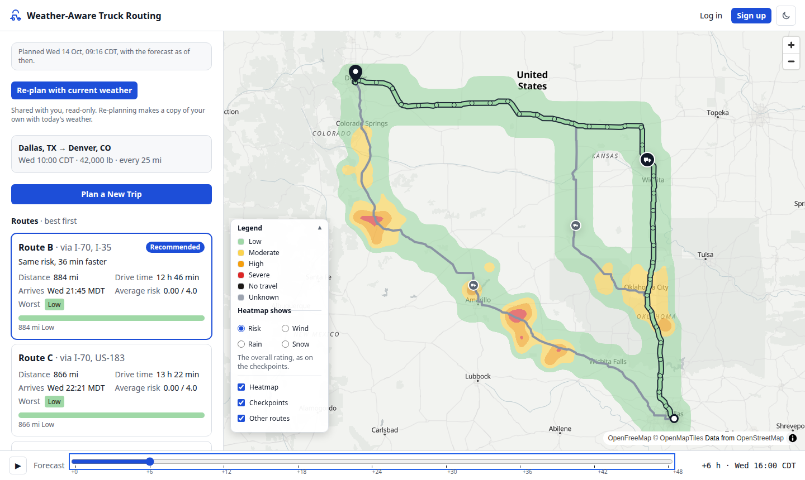
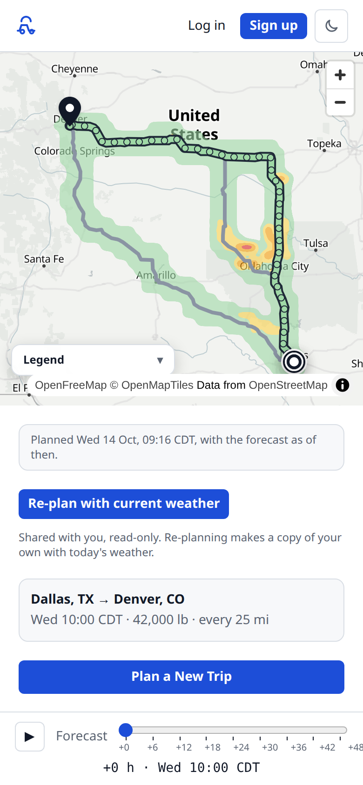
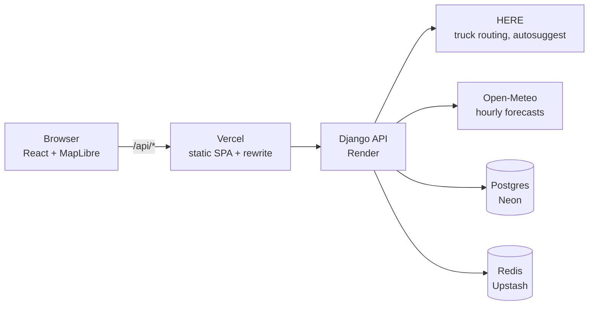

# Weather-Aware Truck Routing

Plan a truck trip and see which route is safest **at the time the truck will actually be
there**. The app compares up to three truck routes, reads the hourly forecast at checkpoints
along each one for the truck's arrival time, rates wind, rain and snow for the load being
carried, and recommends a route with the reason why. A 0–48 hour heatmap shows the weather
moving across the corridor.

**Live app: <https://weather-aware-truck-routing-five.vercel.app>**

> **Running on free tiers.** The hosted app uses free plans on Render, Neon, Upstash and
> Vercel. The server has a fraction of a CPU, so **planning a long trip can take 10–15 seconds,
> and the corridor heatmap can lag** behind the routes, appearing several seconds after them.
> If the server has been idle it may also need up to a minute to wake. The same code is
> instant locally; see [Known limitations](#known-limitations).



<details>
<summary>On a phone</summary>



</details>

## Try it

- Open the [live app](https://weather-aware-truck-routing-five.vercel.app), click **Use the
  demo trip**, then **Plan trip**. No account is needed; guests' trips stay on their device
  for 30 days.
- Or sign in to the demo account, which has four saved trips:

  | Email | Password |
  |---|---|
  | `demo@example.com` | `WATR@2026` |

  It's a shared demo account that is reset to the same four trips whenever it's re-seeded.

## What it does

- **Up to three truck routes** from HERE's truck routing, using the load weight, with
  near-duplicate routes dropped and more found through via points when needed.
- **Checkpoints every 10, 25 or 50 miles**, each with an ETA from the route's real speeds, and
  optionally the driver's **Hours of Service** breaks and rests, which push later ETAs back.
- **The forecast at each checkpoint's ETA** (Open-Meteo, hourly), rated Low, Moderate, High,
  Severe or No travel for wind gusts, rain and snow. Heavy loads raise the wind rating, and a
  missing forecast shows as **Unknown**, never as safe.
- **A recommendation** that ranks routes by No travel, Severe and High miles, then average
  risk, then travel time, with a one-line reason ("Fewest severe miles (0 vs 75)").
- **A map** with each route coloured by risk, checkpoint popups, HOS stops, and a **corridor
  heatmap** you can scrub or play through the next 48 hours, by overall risk or by wind, rain or
  snow.
- **Trips**: every plan is saved. Guests get recent trips on their device; accounts get
  My trips, saving, naming, sharing a read-only link, and re-planning with current weather.

The exact rules, thresholds and their interpretation of the brief are in the
[PRD §7](docs/PRD.md#7-functional-requirements).

## How it works



1. The API asks HERE for truck routes, places checkpoints along each, and works out every
   checkpoint's ETA (and HOS stops, if on).
2. It fetches forecasts for all checkpoints of all routes in a few batched Open-Meteo requests,
   cache-first: points are snapped to a 0.25° grid so nearby trips share cached forecasts.
3. A pure-Python domain package (`backend/planner/domain/`, no Django or network) rates each
   checkpoint, sums each route's miles by risk level, and ranks the routes.
4. The trip is saved and returned. The heatmap is computed on the first request for it, over a
   lattice around the routes, and saved with the trip.
5. The React client draws everything with MapLibre GL. Scrubbing the forecast slider changes
   a paint expression on data already on the GPU, so it never touches the network.

The browser only talks to the Vercel domain, which forwards `/api` to Django, so session and
CSRF cookies are first-party and no CORS is needed.

**Stack:** Django 5, Django REST Framework, django-allauth (headless), Postgres 16, Redis,
httpx · React 18, TypeScript, Vite, TanStack Query, Zustand, react-hook-form + Zod, MapLibre GL,
Tailwind · pytest + Hypothesis, Vitest + Testing Library, Playwright + axe.

## Run it locally

You need **Python 3.12** with [uv](https://docs.astral.sh/uv/), **Node 20**, and
**Postgres 16** running locally (or Docker; see below). No API keys: by default the app uses
built-in fake providers with a demo storm, so it works offline.

```sh
createdb spotter          # the default database: postgres:///spotter as your OS user
make install              # backend and frontend dependencies, plus the git hooks
make dev                  # migrates, then runs the API on :8000 and the web app on :5173
```

Open <http://localhost:5173>, click **Use the demo trip**, then **Plan trip**.

- **Settings** come from environment variables. For local overrides, copy
  `backend/.env.example` to `backend/.env`; everything has a working default.
- **Real routing and weather:** in `backend/.env`, set `PROVIDERS=real` and `HERE_API_KEY=…`
  (a free HERE account). Open-Meteo needs no key. HERE calls count against a monthly budget
  that stops at 90% of the free allowance.
- **The demo account locally:** `cd backend && DEMO_PASSWORD=… uv run python manage.py seed_demo`.
- **With Docker instead:** `make up` runs the API, Postgres, Redis and the web app with
  `docker-compose.yml`.

## Tests and checks

```sh
make test                 # pytest (backend) and Vitest (frontend)
make lint                 # ruff, eslint, prettier
make types                # mypy (strict for the domain and providers), tsc
cd frontend && npx playwright test   # end-to-end stories and axe accessibility checks
```

CI runs the same on every push and PR (`.github/workflows/ci.yml`), plus a dependency audit and
a check that the committed OpenAPI schema and generated TypeScript types are current. Tests
never call HERE or Open-Meteo, whatever `backend/.env` says.

## Key decisions

| Decision | Why | More |
|---|---|---|
| Wind ratings use **gusts**, not sustained wind | Gusts are what push high-sided trucks over; sustained wind is shown for information | [PRD §7.4](docs/PRD.md#74-risk-rules) |
| **Missing data is Unknown**, never Low | A gap in the forecast must not look safe | [PRD §7.4](docs/PRD.md#74-risk-rules) |
| No travel miles **rank before** Severe | A route with any No travel stretch isn't drivable | [PRD §7.6](docs/PRD.md#76-recommendation) |
| Rules live in a **pure domain package** | Table-driven and property tests, readable on their own | [RFC §6](docs/RFC-001-weather-aware-routing.md#6-domain-logic) |
| **HERE** truck routing | The only free option that is truck-aware and returns several alternatives on long trips | [RFC §5.1](docs/RFC-001-weather-aware-routing.md#51-routing-and-geocoding-here-chosen) |
| **Open-Meteo** forecasts on a shared 0.25° grid | Free, hourly, many points per request; the grid lets plans and heatmaps share a cache | [RFC §5.2](docs/RFC-001-weather-aware-routing.md#52-weather-open-meteo-chosen), [§9](docs/RFC-001-weather-aware-routing.md#9-caching-batching-and-quotas) |
| **Budgets for both providers** | HERE stops at 90% of its free monthly allowance; Open-Meteo calls are paced under its per-minute, hour and day limits | [RFC §5](docs/RFC-001-weather-aware-routing.md#5-third-party-providers) |
| One origin through a **Vercel rewrite** | First-party cookies, no CORS | [RFC §3.2](docs/RFC-001-weather-aware-routing.md#32-identity-guests-and-accounts) |

## Known limitations

- **Speed on the free tier.** Measured through the live site on 2026-10-14, for trips of
  about 1,500 miles at 10-mile checkpoints:

  | | Live (free tier) | Target |
  |---|---|---|
  | New plan (cold) | 11–16 s | under 6 s |
  | Same plan again (warm) | 5–7 s | under 1.5 s |
  | New heatmap | 11–13 s | |
  | Saved heatmap | about 1 s | |

  The same warm plan takes 0.15 s on a laptop and 2.1 s when that laptop is limited to 10% of
  one CPU, which is about what the free server gets. A paid instance would close most of the
  gap; the code doesn't change.
- **The heatmap lags the routes.** It's requested once the plan arrives and computed on the
  server's first request for it, so on the free tier it appears several seconds after the
  routes, and on long trips it uses a coarser grid (0.5° instead of 0.25°) to stay under the
  free weather limits.
- **Cold starts.** The free server sleeps after 15 minutes without traffic and takes about a
  minute to wake; the database adds under a second after its own 5-minute sleep.
- **Free quotas.** HERE: 4,000 routing and 4,000 place-search requests a month (the app stops
  at 3,600 and says so). Open-Meteo: 10,000 forecast points a day (the app stops at 9,000),
  enough for about 15 new long trips a day. When the weather limit is reached, the app serves
  recent forecasts it already has or asks you to retry in a minute.
- **North America only**, imperial units, US truck rules.
- **Weather is a forecast**, at hourly resolution and up to 10 days ahead. Ratings follow the
  assessment's thresholds; they aren't an official advisory.
- **No email.** Password reset isn't offered in the app.

## Project layout

```
backend/    Django API: config/ (settings, health, logging), accounts/, planner/
            planner/domain/     pure rules: sampling, ETAs, HOS, risk, metrics, ranking
            planner/providers/  HERE, Open-Meteo, fakes, HTTP client, budgets
            planner/services/   plan orchestration, forecast cache, corridor heatmap
frontend/   React app: src/features/ (trip form, routes, map, timeline, trips, account)
docs/       PRD, RFC, task tracker, deploy runbook
```

## Documentation

- [PRD](docs/PRD.md): users, scope, rules and requirements
- [RFC-001](docs/RFC-001-weather-aware-routing.md): technical design
- [Tasks](docs/tasks.md): the task board and each task's progress log

## Licence

[MIT](LICENSE)
